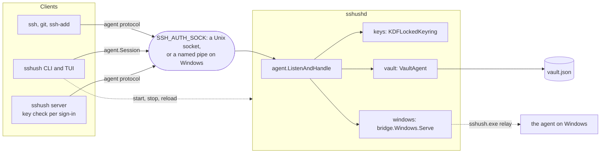
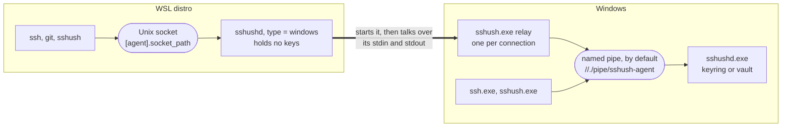
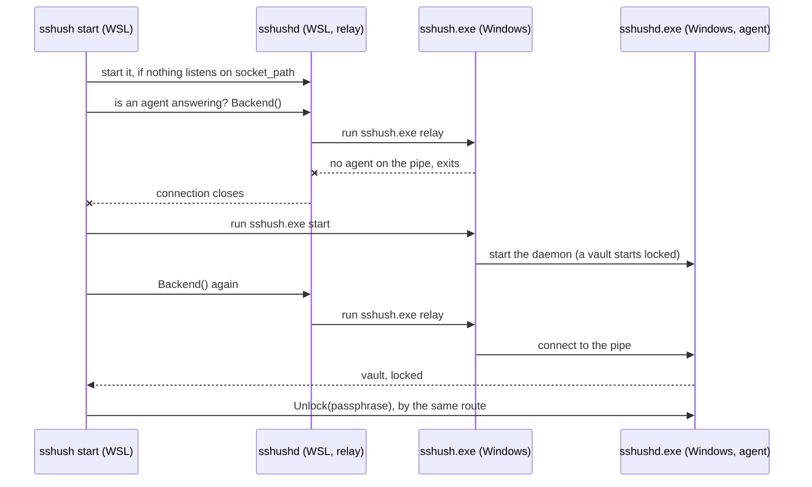

# Architecture

High-level package layout and data flow. For detailed TUI architecture, see [TUI](tui.md). For config flow, see [Config](config.md).

## Layout

- **cmd/sshush** – CLI entry point
- **cmd/sshushd** – Daemon entry point (runs the agent)
- **internal/agent** – SSH agent protocol: serving it over a Unix socket (a named pipe on Windows), and `Session`, the single client entry point for reaching a running agent
- **internal/cli** – Cobra commands (start, stop, reload, list, add, remove, lock, unlock, selftest, create, edit, export, find, validate, generate, vault, server, relay, theme, tui, completion, version)
- **internal/config** – Config load, default creation, shell rc setup
- **internal/clipboard** – Copying text to the system clipboard
- **internal/editcomment** – Editing a key comment in `$EDITOR` through a temp file
- **internal/bridge** – Inside WSL, relays agent connections to the sshush on Windows by running `sshush.exe relay` for each (see [Windows](windows.md#using-it-from-wsl))
- **internal/platform** – Portable defaults for config dir, socket/pid paths, shell rc selection
- **internal/kdf** – Argon2id key derivation, salts and constant-time compare for the vault
- **internal/keys** – Key generation, load, save, comment edit, format
- **internal/openssh** – OpenSSH key parsing
- **internal/readypipe** – Parent/child readiness handshake used when forking `sshushd`
- **internal/runtime** – Config/socket path resolution
- **internal/server** – The TCP SSH server: public-key auth against a file or the agent, optional password auth against the vault's passphrase, and the shell or remote command each session runs, on a pty or over pipes, all logged to a file
- **internal/secfile** – Files and directories only the current user can read: a file mode on Unix, an access list on Windows
- **internal/sshushd** – Daemon start/stop/reload control, and what the daemon serves for each `[agent].type`
- **internal/transport** – Dialling and listening on the agent endpoint: a Unix socket, or a named pipe on Windows (see [Windows](windows.md))
- **internal/style** – Styled terminal output
- **internal/theme** – Colour theme presets, custom hex validation and merging with the default
- **internal/tui** – Bubble Tea TUI (Agent, Create, Edit, Export screens, and Vault when the agent is a vault)
- **internal/utils** – Path expansion, helpers
- **internal/vault** – The encrypted vault: on-disk store, `VaultAgent`, and the `sshush-op` vocabulary
- **internal/vaultops** – The vault operations the CLI and TUI both offer, implemented once
- **internal/version** – Version string

## How the pieces connect

The CLI loads config and starts the daemon. The daemon listens on one endpoint, a Unix socket or on Windows a named pipe (`internal/transport`), and `[agent].type` decides what answers each connection to it: a keyring loaded from `key_paths`, the vault, or, inside WSL, a relay to the agent on Windows ([below](#one-agent-for-windows-and-wsl)). Everything that uses keys reaches them the same way, through `SSH_AUTH_SOCK`: OpenSSH (`ssh`, `ssh-add`, `git`) with the plain agent protocol, sshush's own CLI and TUI through `agent.Session`, and the SSH server when it checks a key. `[agent].type = "external"` is the one case with no daemon of sshush's: the socket is somebody else's agent, and sshush is only a client of it.

## Talking to a running agent

Every client-side conversation with a running agent goes through `agent.Session` (`internal/agent/session.go`). `agent.Open(socketPath)` dials the socket and returns a Session that owns the connection; `Close` releases it. Three rules keep this seam intact:

**One Session per unit of work.** A CLI command opens one Session and carries all of its work over it; a TUI `tea.Cmd` opens one and closes it before returning. Nothing else dials the agent socket. This matters because the interface used to be one function per call, each dialling its own connection: `sshush edit` cost around thirteen connections, and the TUI's two-second vault poll cost two every tick. `Session.Backend` is the reason most of that collapsed — it reports the backend mode *and* whether a vault is locked in one round-trip, where the old probe discarded the response body and forced callers to ask twice.

**`internal/agent` owns the transport; `internal/vault` owns the extension vocabulary.** `Session.Extension` takes an extension name as given. The named wrappers — `vault.AddPrivateKeyFile`, `SetAutoload`, `SetComment`, `SessionLoad`, `SessionUnload`, `UnlockWithRecoveryPhrase` — live in `internal/vault/session_ops.go`, next to the payload builders they use.

**`internal/agent` must not import `internal/vault`.** The dependency runs the other way. That is why the `sshush-op` operation codes (`OpVaultLocked` and the rest) are declared in `internal/agent/op.go` and imported by `internal/vault` to serve each op, and why `Session.Backend` can ask whether a vault is locked without knowing anything about vaults.

**`internal/vaultops` owns the vault operations; the CLI and TUI only render them.** Init, list, add, remove, session-load, autoload, lock and unlock each existed twice — as a cobra `RunE` and as a `tea.Cmd` — and each copy re-derived the same preamble and invented its own wording for the same failure. They now live once in `internal/vaultops`, which takes an `Env` (vault path, socket, and whether the front end can prompt) and returns a typed result. Two properties are worth keeping:

- A verb opens **one** Session however many selectors it is given, which is why the verbs take a slice rather than making callers loop. `RequireVaultAgent` is the one deliberate exception: `sshush vault unlock-recovery` uses it to check the gate, closes that Session, and dials again after the user has typed 24 words, because holding a socket open across an interactive prompt is worse than dialling twice.
- `Env.AskPassphrase` is nil for a front end that cannot block for input. The CLI passes `readPassphrase` and gets the transparent unlock it always had; the TUI passes nothing, because a `tea.Cmd` cannot prompt, and drives its own passphrase modal instead. `Env.AgentVaultPath` keeps the guard that goes with it — a passphrase is only ever asked for on an agent serving the very vault being operated on.

Failures come back as `*vaultops.OpError`: a `Code` to branch on, one sentence in `Msg`, an optional remedy in `Hint`, and the original cause still reachable with `errors.Is`. The CLI renders `Msg` as its error line and `Hint` as the line beneath; the TUI joins them into its status line.

### Why a failure knows its own reason

Server-side error text never crosses the wire. `ServeAgent` answers a failed `Extension` call with a bare `SSH_AGENT_EXTENSION_FAILURE` byte and **discards the response body**, so the client can only synthesise `"agent: generic extension failure"`; a failed `Lock` or `Unlock` becomes `"agent: failure"`. Every distinct cause — locked vault, unknown identity, wrong passphrase, a vault created with `--no-recovery` — arrived as one string, and callers guessed at the reason by matching it.

Because a returned error discards the body, the reason cannot ride on the failure path. The `sshush-op` extension (`internal/agent/op.go`) therefore answers a *failed* request with protocol-level **success**, carrying a status byte in the body. `Session.Op` decodes that into a sentinel — `agent.ErrVaultLocked`, `ErrIdentityNotFound`, `ErrNoRecovery`, `ErrWrongPassphrase`, `ErrNotLocked` — which callers match with `errors.Is`.

**`sshush-op` is the only way in.** One extension carries every operation: requests are `[version][op][payload]`, responses `[version][status][data]`. `VaultAgent` and `KDFLockedKeyring` each serve the ops that make sense for them, and a keyring reports the vault ops unknown. The per-operation extensions that preceded it — `vault-locked`, `unlock-recovery`, `add-key-opts`, `vault-session-load`, `vault-session-unload`, `vault-set-autoload`, `vault-set-comment` — are gone, so `query` now returns just `query` and `sshush-op`.

That makes the wire format a breaking change between sshush versions, which is why `Backend` carries `SpeaksOps`:

| the agent | `Mode` | `SpeaksOps` |
|---|---|---|
| this sshushd, vault mode | `vault` | true |
| this sshushd, keys mode | `keys` | true |
| a foreign agent, or an sshushd older than `sshush-op` | `keys` | false |

A command that needs a vault and finds `SpeaksOps` false says so, because the usual cause is upgrading `sshush` while the old daemon is still running — `sshush reload` fixes it. Nothing else can tell those two situations apart, since neither answers the extension.

`ErrOpUnknown` is deliberately distinct from `ErrOpUnsupported`: the first means this agent speaks the protocol but not that operation, the second that it does not speak the protocol at all.

`Session.Lock` and `Session.Unlock` still fall back to the plain agent protocol when `sshush-op` is unsupported. That is not a legacy path — a real `ssh-agent` or 1Password implements lock and unlock natively, and `[agent].type = "external"` points at exactly those.

### The agent answers for its own vault

What a vault holds is the agent's to say. The `list-identities` op returns every identity in the vault the daemon serves — fingerprint, public key, comment, autoload flag and the path it was added from — including the ones it is not listing to `ssh` this session, and `internal/vaultops` resolves a fingerprint, comment or key file against that. So `sshush vault …` needs no access to the vault file, which is what lets a client in one environment drive a daemon in another: sshush in WSL, a daemon on Windows, a relay between them.

`vaultops` picks its source in one place (`conn.roster`):

| | the vault's contents come from |
|---|---|
| a vault agent answers | the agent |
| it refuses because the vault is locked, or because it predates the op (`ErrOpUnknown`) | `[vault].vault_path`, if set; otherwise the verb reports the lock, or that the daemon is too old |
| no agent, or a keys agent | `[vault].vault_path` |
| `--vault-path` was given | that file, whatever is running |

A locked vault refuses on purpose. `List` answers a locked agent with nothing, and `list-identities` is not a way around that for whoever can reach the socket: a relay, or a host the agent was forwarded to. The client either reads the file it already has access to or asks for the passphrase.

For the same reason the transparent unlock and the TUI's Vault tab follow `Backend()`, not `[agent].type`: a config that says `external` cannot know what it is pointed at, and the agent can. Only for a vault named with `--vault-path` does config decide — the prompt is skipped unless config says the agent serves that very file.

The listing is SSH wire data in which each identity is its own length-prefixed record, and both the listing and a record may carry trailing fields this version does not read. Adding a field is therefore not a format break; see `internal/vault/list.go`.

### One agent for Windows and WSL

`[agent].type = "windows"` is for an sshush inside WSL. Neither a named pipe nor a Unix socket crosses the WSL boundary, but a process does: a Linux process can start a Windows one and talk to it over stdin and stdout. So `sshushd` in the distro listens on its Unix socket as usual and, instead of answering from a keyring, hands each connection to a freshly started `sshush.exe relay` (`internal/bridge`), which copies between its stdio and the Windows agent's pipe. The agent protocol passes through untouched; the Linux daemon holds no key and no unlock.

Each side has one job. In the distro, `bridge.Windows.Serve` waits for a connection's first bytes, then starts the relay for it and copies until either end closes; `bridge.Find` locates `sshush.exe`, on `PATH` or at `[agent].windows_sshush`. The wait costs nothing, since in the agent protocol the client always speaks first, and it keeps the many connections that never speak from each starting a Windows process: "is something listening?" (`CheckAlreadyRunning`) is asked by connecting and hanging up. On Windows, `sshush relay` dials the agent's pipe and runs `bridge.Relay` over its own stdin and stdout; it ends as soon as either direction does, because input ending means the client has gone. `relay` skips first-run setup: it is run once per connection, by a program.

Clients on Windows are not part of this. `ssh.exe` and `sshush.exe` connect to the pipe directly, as they would with no WSL at all.

Everything above then applies unchanged, because the client is still talking to an sshush agent: `Backend()` says whether it is a vault, `list-identities` says what it holds. Two things follow from the agent living elsewhere, and the same two hold for `type = "external"`:

- **Config does not own the agent's keys.** `Config.OwnsAgentKeys()` is false, and `reload` never reconciles them: `key_paths` here says nothing about what that agent should hold, so reconciling would remove every key it lists — and from a vault, removing is deleting. For `"windows"`, reload restarts the relay; for `"external"` it refuses.
- **A relay accepts the connection whether or not anything is behind it.** A connection that goes quiet is therefore the agent being down, not a foreign agent, and is reported as such (`windowsAgentDown` in the CLI, `CodeNoAgent` from `vaultops`).

`sshush start` in the distro starts both halves: the relay, then, if no agent answers through it, `sshush.exe start` on the Windows side. From cold on both sides:

With the relay or the agent already running, the matching steps are skipped: an agent that answers the first `Backend()` means `sshush.exe start` is never run. That answer is also all `start` needs to know about the agent, so the session it arrived on is kept for the unlock and the key list, and the `Agent:` line the CLI prints ahead of other commands is printed by `start` from it rather than fetched separately (`commandPrintsAgentMode`). A new shell that finds everything running therefore costs one connection, which is one relay process. The passphrase prompt comes only when this run started one of the halves and the agent is a locked vault, so a new shell that finds everything running is not asked. The daemon's readiness handshake ([below](#daemon-startup)) covers the relay's own socket and nothing more: a relay is ready before anything is behind it, which is why `start` asks for a round trip rather than trusting the connection.

The relay itself never starts the Windows daemon, so `sshush stop` on Windows stays stopped however many clients in WSL go on polling.

Agent state — a vault's master key and session-load sets, a keyring's lock state — lives in the agent process and is shared by every connection it serves (`internal/agent/server.go` hands the same keyring to every `ServeAgent`). How many Sessions a caller opens therefore has no bearing on what the agent reports.

Two things deliberately do not use a Session. `internal/sshushd`'s liveness probes (`CheckAlreadyRunning`, `WaitForSocket`) dial and close without speaking the protocol, so a Session would spawn a client and a goroutine to learn nothing. And the SSH server's `server.SocketAuth` dials the agent socket directly for each authorization, because all it needs is `List` over the plain agent protocol.

`SocketAuth` dialling per check, rather than the server holding one agent client for its lifetime, is what lets `sshush server` start before `sshush start` and survive a `reload`. A held connection dies with the agent that served it, and the server would go on refusing every key until someone restarted it — with nothing on either side saying why. Per-connection dialling costs one Unix socket dial per SSH handshake and needs no reconnect logic. `server.AgentAuth`, typed against `sshagent.Agent`, is still the comparison itself, and is what tests use directly.

## Daemon startup

`sshush start` (and `sshush server`) fork `sshushd` as a detached background process (`internal/sshushd.StartDaemon` / `StartServerDaemon` in `control.go`) and need to know once it's actually up before returning. Printing the `export SSH_AUTH_SOCK=...` line, or the server's listen confirmation, only makes sense once the socket or port is really accepting connections.

That readiness check is a synchronous handshake, not a poll loop:

1. The parent opens a pipe (`internal/readypipe.New`) and passes the write end to the child as an inherited file descriptor (`exec.Cmd.ExtraFiles`), telling it which fd number to use via the `SSHUSH_READY_FD` environment variable.
2. The child (`cmd/sshushd/main.go`) picks the pipe up with `readypipe.FromEnv()`. Every failure path (config load, an already-running check, vault/key errors, a listen failure) calls `ready.Fail(err)` with the real error text before exiting.
3. On success, the child signals readiness with a bare close of the pipe, fired at the exact point the listener comes up: inside `agent.ListenAndHandle` (via the `WithReady` option) for the agent socket, whatever answers its connections, and inside `server.Server.ListenAndServe` (via the `Ready` field) for the TCP server.
4. The parent blocks on `Parent.Wait`, reading until EOF. No data read means success; data read is the child's real error text, returned verbatim; a 5-second deadline is the fallback for a child that never signals either way. It's a dead man's switch, not the primary mechanism.

Because the child's write end is the only thing keeping the pipe open, an unclean child death (crash, `SIGKILL`) closes it via the kernel automatically, so the parent still unblocks with an EOF-based failure without either side needing extra bookkeeping.

`sshushd` launched by hand (outside `sshush start`/`sshush server`) has no `SSHUSH_READY_FD` set, so `readypipe.FromEnv()` returns `nil` and every `Child` method becomes a no-op. The daemon starts the same way either way.
